<div align="center">


# ROOT ACCESS

### Conferencia de Ciberseguridad · Universidad Privada Antenor Orrego

**El conocimiento también es una forma de defensa.**

*1.ª edición: el primer evento de ciberseguridad de la UPAO*

📅 **19 y 20 de noviembre de 2026** &nbsp;·&nbsp; 📍 **Campus UPAO, Trujillo, Perú** &nbsp;·&nbsp; ⏱️ **16 horas netas**

<br />


<br />

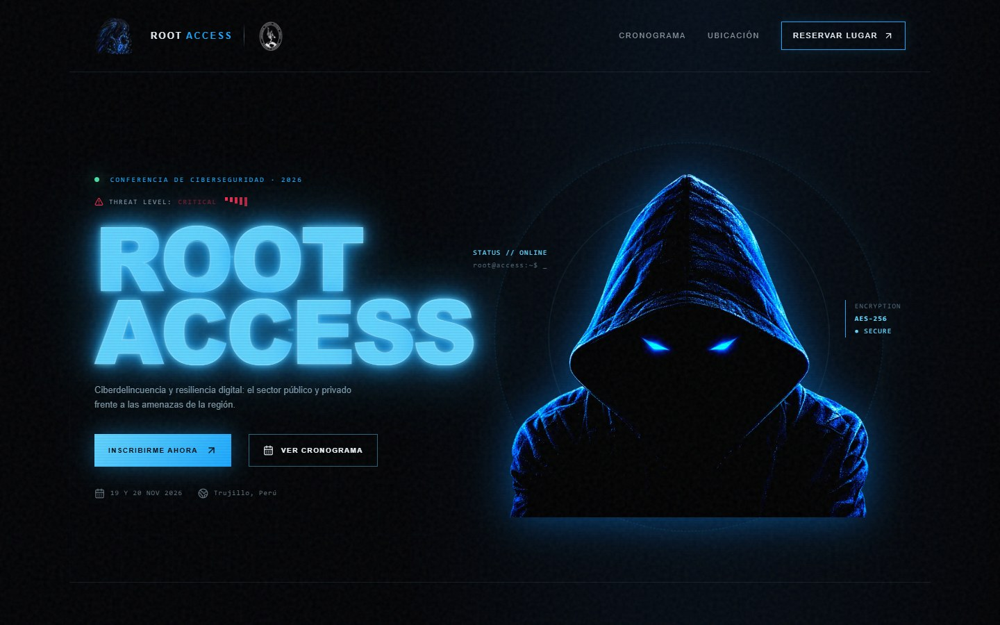

</div>

---

## Contenido

- [Sobre el evento](#sobre-el-evento)
- [Recorrido visual](#recorrido-visual)
- [Funcionalidades](#funcionalidades)
- [Stack](#stack)
- [Empezar](#empezar)
- [Comandos](#comandos)
- [Variables de entorno](#variables-de-entorno)
- [Estructura del proyecto](#estructura-del-proyecto)
- [Editar el contenido](#editar-el-contenido)
- [Seguridad](#seguridad)
- [Organiza](#organiza)

---

## Sobre el evento

**Root Access** es el primer evento de ciberseguridad organizado por la **Universidad Privada Antenor Orrego**, una iniciativa de la **Escuela de Ingeniería de Sistemas e Inteligencia Artificial** que reúne a la academia, la industria y el sector público.

| | |
|---|---|
| 🎤 **10 h de conferencias** | Caja Trujillo, Huawei, Fortinet, Virú Group, Gold Fields, Fiscalía y más |
| 🛠️ **6 h de talleres prácticos** | Análisis forense con Autopsy · Análisis de malware · Wazuh SIEM |
| 👥 **11 especialistas invitados** | Más dos paneles de estudiantes de Ingeniería de Sistemas |

Este repositorio contiene la **web oficial del evento**: portada, cronograma interactivo y acceso al formulario de inscripción.

---

## Recorrido visual

### La UPAO abre sus puertas a la ciberseguridad
Sección institucional con el escudo oficial (con el mismo efecto *glitch* que el resto del sitio), las cifras de la edición y la universidad organizadora.

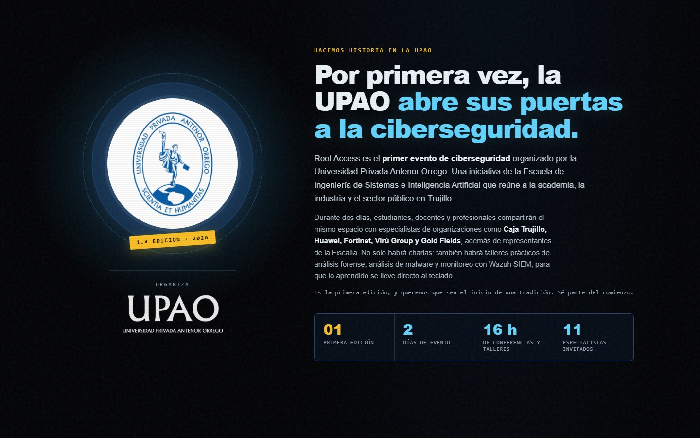

### La seguridad empieza con una pregunta
Las preguntas que responde el programa, presentadas como una terminal. Cada una está enlazada a su taller o conferencia real.

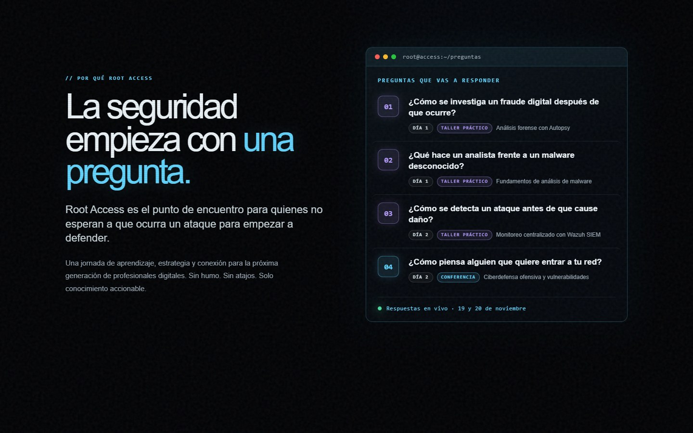

### Áreas de acceso
Seis ejes temáticos con las sesiones concretas donde se ven. Usan el mismo código de color que el cronograma: **cian** para conferencias y **violeta** para talleres prácticos.

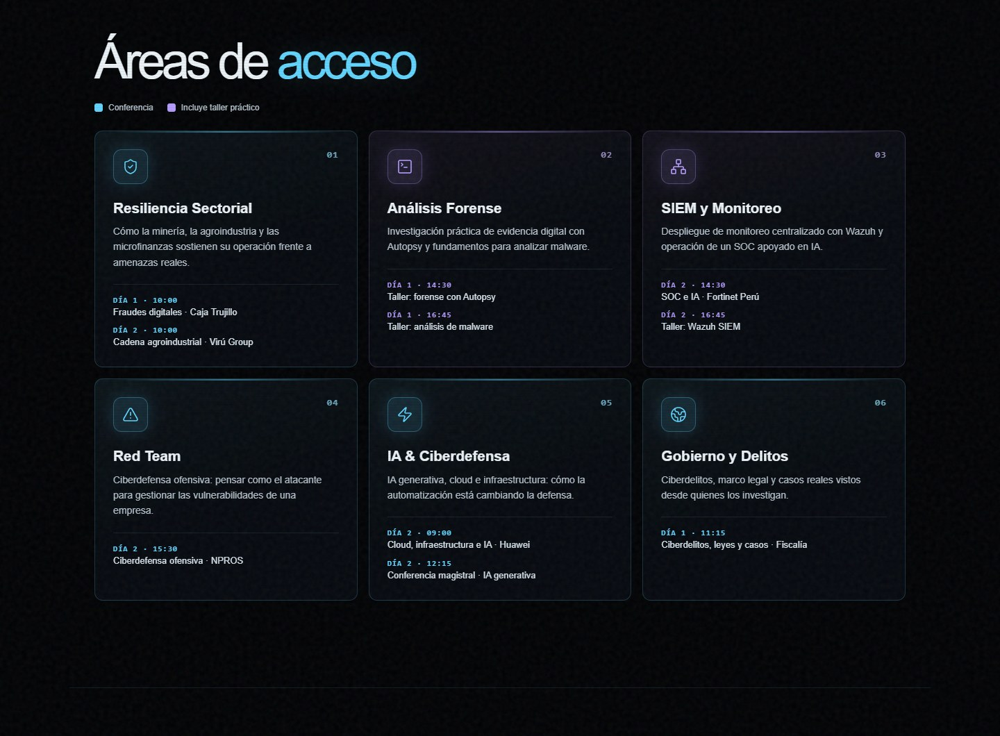

### La defensa es un oficio
La coordinación del evento y las autoridades de la Escuela que lo respaldan.

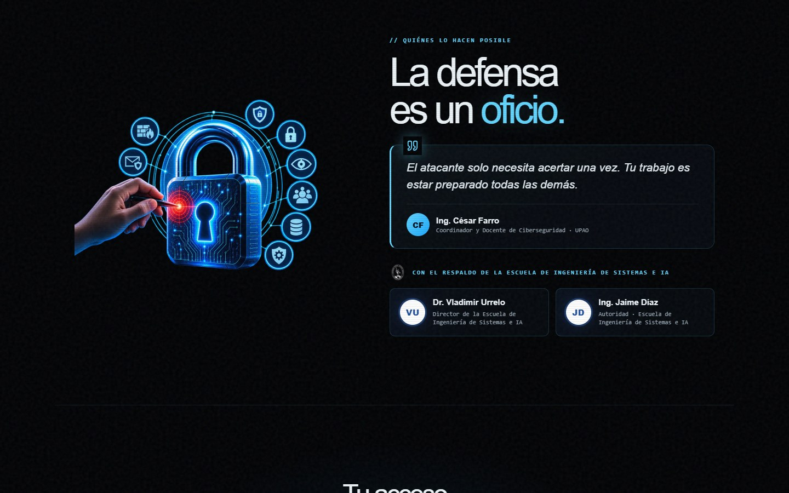

### Cuenta regresiva y footer
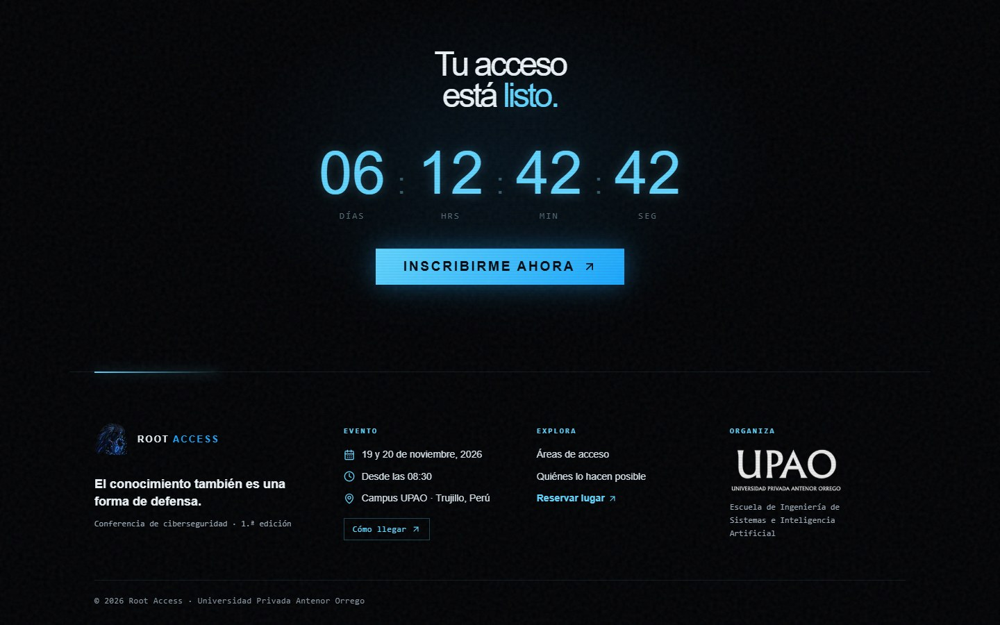

### Cronograma interactivo
Pestañas por día fijas al hacer scroll, color por tipo de actividad, duración de cada sesión y recesos discretos. Los días 19 y 20 de noviembre, además, abre solo el día en curso y marca **EN VIVO** la sesión que está ocurriendo (hora de Lima).

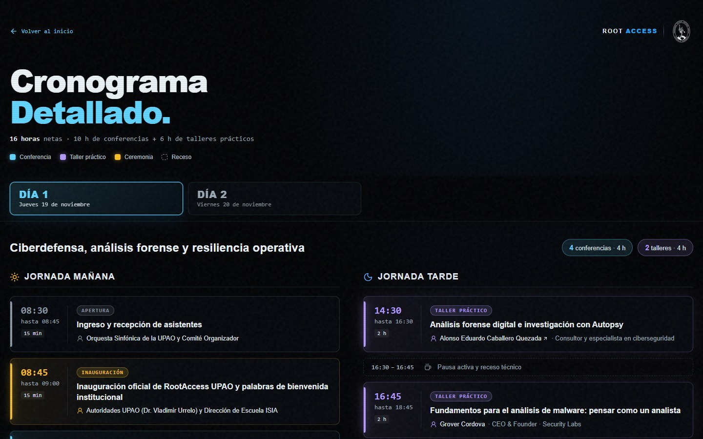

### Diseño responsive

<table>
  <tr>
    <td align="center" width="50%">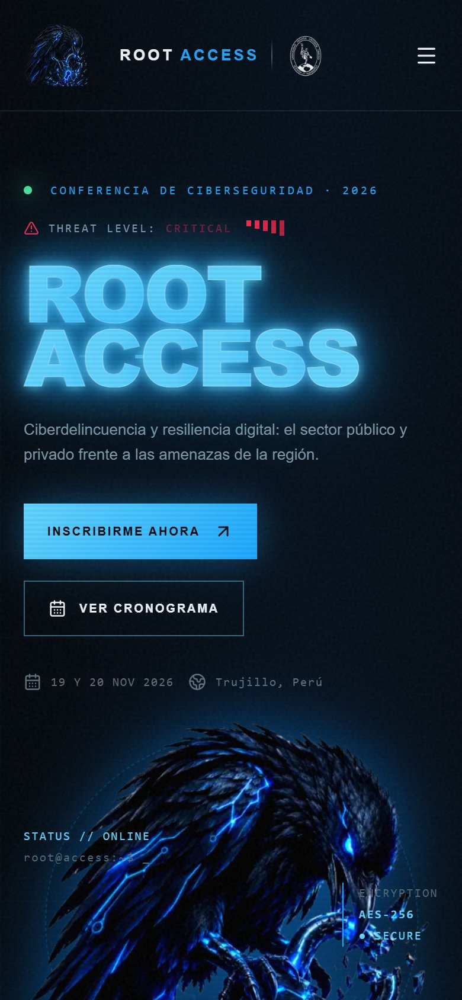<br /><sub><b>Portada en móvil</b></sub></td>
    <td align="center" width="50%">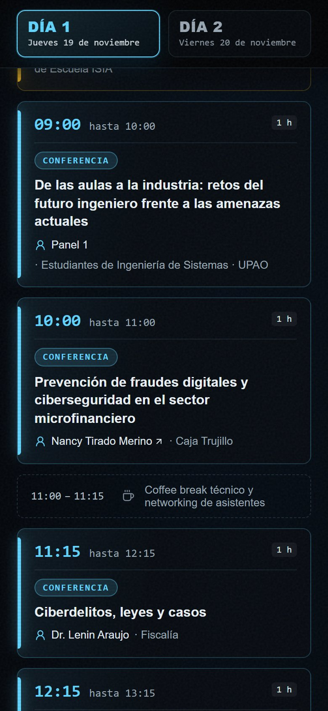<br /><sub><b>Cronograma en móvil</b></sub></td>
  </tr>
</table>

### Acceso al formulario
Al pulsar **Reservar lugar** o **Inscribirme ahora** se reproduce una cinemática: el sistema es *vulnerado*, se recupera y termina en *"Dándote acceso al formulario… Bienvenido"*, antes de llevar al formulario de inscripción.

<table>
  <tr>
    <td width="50%">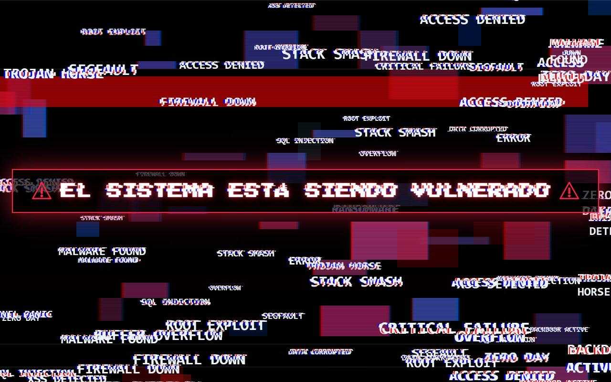</td>
    <td width="50%">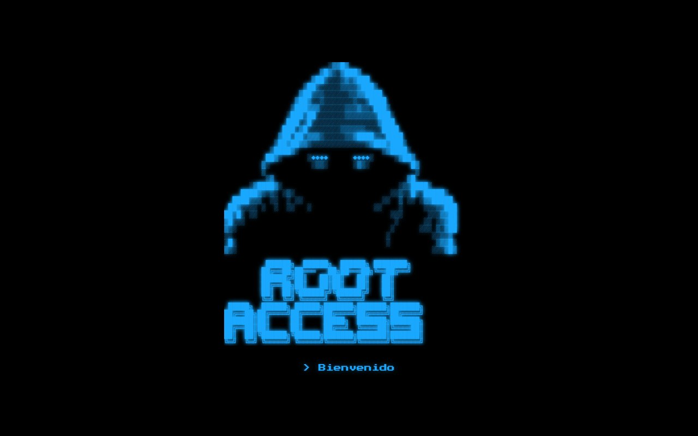</td>
  </tr>
</table>

---

## Funcionalidades

- **Cronograma vivo:** pestañas accesibles (patrón WAI-ARIA Tabs, navegables con flechas), indicador *EN VIVO* y apertura automática del día en curso, sin errores de hidratación (el HTML del servidor no depende de la hora).
- **Cinemática de acceso:** sigue siendo un enlace real (`<a href>`). Funciona sin JavaScript, respeta Ctrl/Cmd + clic para abrir en otra pestaña, se cancela con **Esc** y se omite si el sistema tiene *movimiento reducido* activado.
- **Accesibilidad:** foco visible, textos alternativos, contraste ≥ 4.5:1 en textos clave y animaciones desactivadas con `prefers-reduced-motion`.
- **Diseño responsive** probado a 390 px (móvil) y 1440 px (escritorio), sin scroll horizontal.
- **Contenido como datos:** el cronograma, los temas y las preguntas salen de arrays tipados, así que actualizar el programa no requiere tocar el diseño.

---

## Stack

| Capa | Tecnología |
|---|---|
| Framework | [Next.js 16](https://nextjs.org) (App Router, Turbopack), páginas estáticas |
| UI | React 19 · TypeScript 5.7 |
| Estilos | Tailwind CSS 4 + CSS propio con *design tokens* (`app/globals.css`) |
| Iconos | [lucide-react](https://lucide.dev) |
| Tipografía | `next/font` (Press Start 2P en la cinemática) |
| Inscripción | Google Forms (el formulario propio de `/inscripcion` queda disponible para un backend) |
| Gestor de paquetes | pnpm 12 (vía Corepack) |

---

## Empezar

**Requisitos:** Node.js 20 o superior (incluye Corepack).

```bash
# 1. Instalar dependencias (Corepack usa la versión de pnpm declarada en package.json)
corepack pnpm install

# 2. (Opcional) Variables de entorno
#    Crea .env.local con las variables de la sección "Variables de entorno"

# 3. Servidor de desarrollo
corepack pnpm dev
```

Abre <http://localhost:3000>.

> [!TIP]
> Si pnpm ya está instalado globalmente, puedes omitir `corepack` y usar `pnpm install` / `pnpm dev` directamente.

---

## Comandos

<!-- AUTO-GENERATED: package.json scripts -->
| Comando | Descripción |
|---|---|
| `pnpm dev` | Servidor de desarrollo con recarga en caliente (`next dev`) |
| `pnpm build` | Build de producción con verificación de tipos (`next build`) |
| `pnpm start` | Sirve el build de producción (`next start`) |
| `pnpm typecheck` | Verificación de tipos sin emitir archivos (`tsc --noEmit`) |
| `pnpm lint` | Análisis estático con ESLint (`eslint .`) |
<!-- /AUTO-GENERATED -->

---

## Variables de entorno

<!-- AUTO-GENERATED: process.env usados en app/, lib/ y next.config.mjs -->
| Variable | Requerida | Descripción | Ejemplo |
|---|---|---|---|
| `NEXT_PUBLIC_API_URL` | No | Backend del formulario propio de inscripción. También se agrega a `connect-src` en la CSP. Sin ella, en desarrollo el formulario usa un **modo demo**; en producción muestra un error en vez de simular inscripciones. | `http://localhost:8080` |
| `NEXT_PUBLIC_SITE_URL` | No | URL pública del sitio, usada en las vistas previas al compartir (Open Graph). Si falta, usa `VERCEL_PROJECT_PRODUCTION_URL` y luego `http://localhost:3000`. | `https://tu-dominio.com` |
| `VERCEL_PROJECT_PRODUCTION_URL` | No | La define Vercel automáticamente; respaldo de `NEXT_PUBLIC_SITE_URL`. | (automática) |
<!-- /AUTO-GENERATED -->

> [!NOTE]
> Todas son públicas (`NEXT_PUBLIC_*`) y terminan en el bundle del navegador: **nunca** pongas secretos en ellas. Los archivos `.env*` están en `.gitignore`.

---

## Estructura del proyecto

```text
paginaconferencia/
├── app/
│   ├── page.tsx                 # Portada (secciones, temas, preguntas, autoridades)
│   ├── cronograma/page.tsx      # Cronograma: datos del programa + render
│   ├── inscripcion/page.tsx     # Formulario propio (hoy redirige a Google Forms)
│   ├── layout.tsx               # Metadata, Open Graph, fuentes
│   └── globals.css              # Design tokens y estilos del sitio
├── components/
│   ├── brand/upao-logo.tsx      # Escudo y logotipo UPAO
│   ├── cronograma/
│   │   ├── day-switcher.tsx     # Pestañas de día (WAI-ARIA Tabs)
│   │   └── live-clock.tsx       # Reloj compartido (hora de Lima) + indicador EN VIVO
│   ├── home/
│   │   ├── site-header.tsx      # Header con logos y menú
│   │   ├── first-edition.tsx    # Sección institucional "Por primera vez, la UPAO…"
│   │   ├── site-footer.tsx      # Footer con ubicación
│   │   └── effects.tsx          # Título eléctrico, glitches, cuenta regresiva
│   └── registro/
│       ├── reserve-link.tsx     # Enlace a inscripción con la cinemática
│       └── hack-cinematic.tsx   # Cinemática compartida (también la usa /inscripcion)
├── lib/
│   ├── links.ts                 # URL del formulario de inscripción
│   └── inscripcion-api.ts       # Cliente del backend del formulario propio
├── public/                      # Logos, imágenes y escudo UPAO
├── docs/screenshots/            # Capturas de este README
└── next.config.mjs              # Cabeceras de seguridad (CSP) y redirección de /inscripcion
```

---

## Editar el contenido

| Quiero cambiar… | Archivo |
|---|---|
| Horarios, ponentes o sesiones del programa | `app/cronograma/page.tsx` (`day1Morning`, `day1Afternoon`, `day2Morning`, `day2Afternoon`) |
| Tarjetas de *Áreas de acceso* | `app/page.tsx` → `topics` |
| Preguntas del manifiesto | `app/page.tsx` → `QUESTIONS` |
| Autoridades de la Escuela | `app/page.tsx` → `AUTHORITIES` |
| Cifras de la sección UPAO (16 h, 11 especialistas…) | `components/home/first-edition.tsx` → `FACTS` |
| Enlace del formulario de inscripción | `lib/links.ts` **y** la redirección en `next.config.mjs` (deben coincidir) |
| Duración de la cinemática | `components/registro/reserve-link.tsx` → `AT` |
| Ubicación de "Cómo llegar" | `components/home/site-footer.tsx` → `MAPS_URL` |

> [!IMPORTANT]
> Las cifras de la sección UPAO y los horarios de *Áreas de acceso* se escriben a mano. Si cambia el programa, actualízalos junto con el cronograma.

---

## Seguridad

- **Cabeceras:** Content-Security-Policy, `X-Frame-Options: DENY`, `frame-ancestors 'none'`, `X-Content-Type-Options: nosniff`, `Referrer-Policy`, `Permissions-Policy` y HSTS en producción (`next.config.mjs`).
- **Dependencias:** `pnpm audit --prod` sin vulnerabilidades conocidas (Next.js 16.4.6).
- **Enlaces externos** con `rel="noopener noreferrer"`. No hay secretos en el código.
- **Deuda conocida:** `script-src` permite `'unsafe-inline'` porque Next.js lo necesita para hidratar sin nonces. Eliminarlo requiere generar nonces en un middleware.

```bash
corepack pnpm audit --prod   # revisar dependencias de producción
```

---

## Organiza

<div align="center">


**Universidad Privada Antenor Orrego**
Escuela de Ingeniería de Sistemas e Inteligencia Artificial

*Comité Organizador Root Access*

<br />

Distribuido bajo la licencia [Apache 2.0](LICENSE).

</div>
